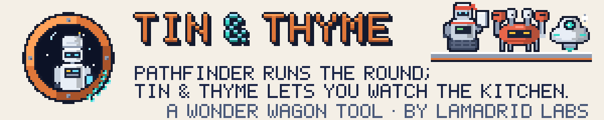
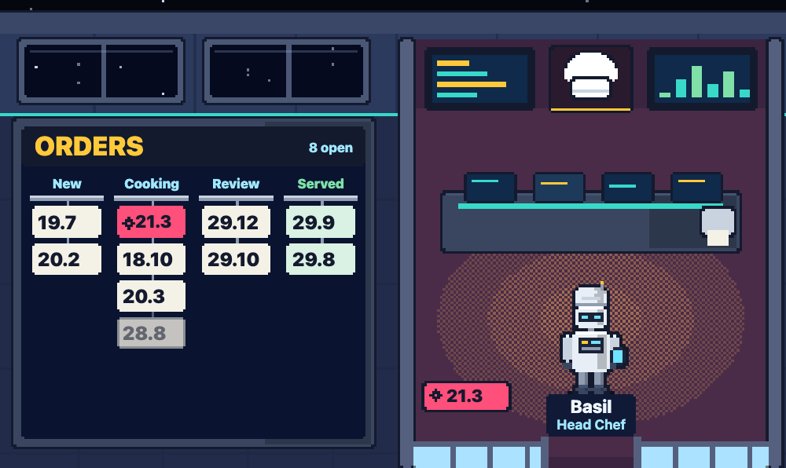
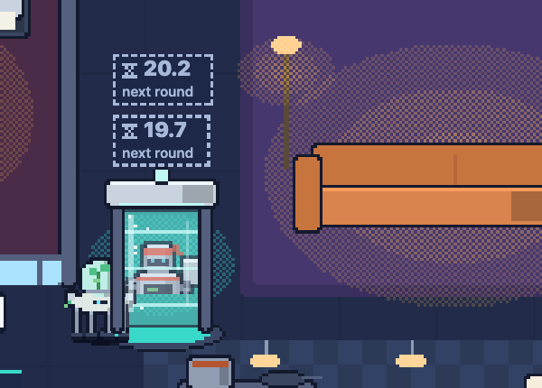
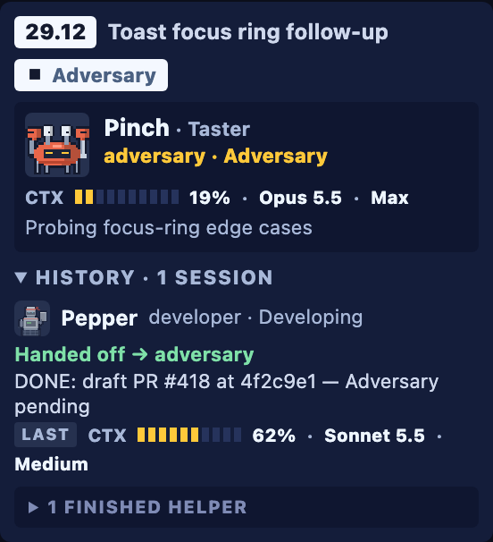
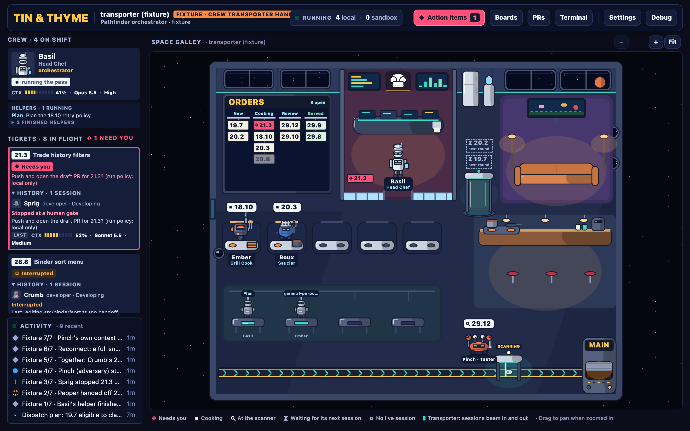

<picture>
  <source media="(prefers-color-scheme: dark)" srcset="brand/readme/header-night.svg">
  
</picture>

**Watch a Pathfinder orchestration run as a robot kitchen, and step in only when it needs you.**<br>
Pathfinder runs the round; Tin & Thyme lets you watch the kitchen.

A [Wonder Wagon](https://github.com/rikilamadrid/wonder-wagon-ui) tool, shelved beside
[Pathfinder](https://github.com/rikilamadrid/pathfinder),
[Lorekeeper](https://github.com/rikilamadrid/lorekeeper) and
[Forge](https://github.com/rikilamadrid/forge).

[Quick start](#quick-start) ·
[Tour](#a-tour-of-the-kitchen) ·
[How it works](docs/how-it-works.md) ·
[Troubleshooting](docs/troubleshooting.md) ·
[Verification](docs/verification.md) ·
[Identity](brand/IDENTITY.md) ·
[Changelog](CHANGELOG.md)


<sub>The labelled sample scene (`?fixture=handoff`), not a live run: the toolbar says <b>Fixture · crew transporter handoff</b>, and every ticket, name and reading is sample data.</sub>

Tin & Thyme is a local web app for one job: seeing what a
[Pathfinder](https://github.com/rikilamadrid/pathfinder) orchestration is doing,
right now, in the repository you are in. One command opens a kitchen for that
repository, with its roles, its ticket board and any existing claims already
loaded:

```sh
tin-and-thyme open .
```

Pathfinder decides what runs, records every stage, and keeps approval, acceptance,
merge and release with you. Tin & Thyme reads what Pathfinder records and what
Claude Code reports, and draws it: the orchestrator in its office, short-lived
worker sessions beaming in to cook a ticket and beaming out when they hand it on,
human gates in pink, and finished work riding the belt into **MAIN**. Opening a
kitchen never approves, claims or dispatches anything, and Tin & Thyme writes
nothing into your repository.

## Quick start

You need macOS (verified; Linux should work but is not verified yet), Node.js 20
or newer, Git, and a repository with the Pathfinder kit. To run an orchestration
from the kitchen you also need Claude Code and tmux; for a GitHub Issues ticket
store, the GitHub CLI (`gh`).

Try it without installing anything, from a repository that has the Pathfinder kit:

```sh
npx tin-and-thyme@latest open .
```

Or install the command once:

```sh
npm install -g tin-and-thyme
tin-and-thyme --version
```

Then, from any repository that has the Pathfinder kit:

```sh
cd ~/Workspace/my-app
tin-and-thyme open .                    # open (or reuse) this repository's kitchen in your browser
tin-and-thyme open ~/Workspace/other    # or name any repository
tin-and-thyme open . --no-browser       # start or reuse it, and print the URL instead
tin-and-thyme url .                     # the URL of the kitchen already running
tin-and-thyme list                      # every kitchen, and whether it still answers
```

No Pathfinder kit yet? `open` says what is missing and how to add it yourself
(`npx create-pathfinder --mode orchestrator` in that repository). Tin & Thyme
does not set anything up for you.

When you want work to run, start the Head Chef: **Start team** in the top bar,
or **Start Basil** in its drawer. That launches Pathfinder's coordinator in
Claude Code (`/orchestrate start`), and Pathfinder asks for your approval before
it claims a single ticket.

Closing the browser stops nothing: the kitchen keeps running, and `open` or `url`
brings you back. What starts, what is reused and what is kept where is in
[How it works](docs/how-it-works.md).

## A tour of the kitchen

### The Head Chef and the Orders rail



- **The Head Chef** is Pathfinder's orchestrator: one Claude Code session that
  Tin & Thyme starts in tmux, running `/orchestrate start`. It works in the glass
  office. When it ends its turn on a real ask (an open gate, a permission
  prompt, or a question with no workers running), it shows **Needs you**. When
  it ends its turn while workers it dispatched are still running, it shows
  **Waiting on workers**.
- **The Orders rail** shows every ticket Pathfinder's engine reports, from New to
  Served. A ticket waiting on you is pink here and in the Head Chef's hand.
- **Helpers** the coordinator delegates (searches, plans) work at the subagent
  stations, under the name of the session that launched them.

### The crew and the Crew Transporter



**Workers are disposable.** Each Pathfinder stage (implementation, adversary,
review, repair) runs as its own background session of the coordinator, seen
through Claude Code hooks. A robot is on the floor only while its session runs:
developers cook at the prep line; testers and adversaries work at the review
scanner over the belt.

Sessions arrive and leave through a glass tube beside the prep line:

- a worker **beams in** only when its session is observed to start, then walks to
  its station;
- when it stops, it walks back and **beams out**, and its station is free again;
- several at once take turns, and each beam runs shorter;
- with reduced motion there is no beam at all: robots simply appear and leave.

Work itself never uses the tube. Tickets travel by the belt, the scanner and the
**MAIN** hatch.

### Ticket cards and stage handoffs



Every ticket in flight has one card in the left column, and it outlives the
sessions that work on it. When a developer finishes and Pathfinder records the
next stage, the card reads **Waiting for adversary** until that session actually
starts; then it shows the new worker, its stage, and that session's own context,
model and effort. Each finished session stays in the card's **History**, with
how it ended and its last readings.

A card also tells you when something needs a person:

- **Needs you**, in pink, for a human gate. Pathfinder's own question stays on the
  card and in **Action items** after the worker has left, with its ticket, stage,
  and the session that raised it (or **Unable to identify session**, and why).
  **Send answer** types your reply into the coordinator's session once; the
  request then shows **Sending**, **Delivered**, and **Recorded** only when
  Pathfinder shows the gate resolved. **Snooze** sends nothing and leaves the gate
  open. Each request is one gate occurrence in Pathfinder's own record (its
  `Gate-Id`): the same question raised again is a new request, an answer to an
  earlier one is refused, and a session is named only when its own report was
  made in that occurrence. A gate with no occurrence in the record never names a
  session, and stays answerable.
- **Ready to deliver** when the review passed (Pathfinder `done`), **In review**
  only while a review is underway, **Awaiting merge** once a pull request is open,
  and **Done / Served** when the ticket is integrated and complete. The board, the
  ticket cards, the plan wall and the drawer all use the same words.
- **Interrupted** when a session stopped without recording a handoff or a report.
  A session that reported PASS, FINDINGS, DONE, GATE or FAILED is shown with its
  own report. No success sound plays.
- **Ready for next round** when the coordinator's latest plan lists the ticket as
  eligible and waiting for another approved dispatch.

<br clear="right">

### Terminals, telemetry and sound

- Each crew member's drawer has a **terminal**: the Head Chef's is its live
  Claude Code session. A worker's is a read-only **Activity** view of the tools it
  runs: a background session can't be typed to, so its requests are answered in
  **Action items**, through the coordinator.
- **Activity** lists what happened, newest first: starts, handoffs, gates, plans
  and deliveries.
- **Context, model and effort** are read from each session's own transcript. A
  value that is not reported shows **—**, never a guess.
- **Context alerts** (Settings → Context, 35% by default) flag a live worker
  whose context crosses the threshold. They are advisory: nothing restarts on its
  own.
- **Sound** (Settings → Audio) is off by default. When on, short cues mark a new
  human decision, a beam-in, a handoff, a ticket moving, a passing review and a
  confirmed merge. Refreshes and reconnects never replay them.

### Two ways to draw it

The same kitchen in **Detailed pixel art** (whole pixels, ink outlines, dithered
light) or **Cel-shaded** (inked vector shapes with one flat shadow each). Switch
in **Settings → Appearance**; nothing else changes.



## Further reading

| Document | What it covers |
| --- | --- |
| [`docs/getting-started.md`](docs/getting-started.md) | From install to watching your first round |
| [`docs/how-it-works.md`](docs/how-it-works.md) | What runs on your machine, the Pathfinder adapter, hooks, and what is kept where |
| [`docs/tin-and-thyme-cli.md`](docs/tin-and-thyme-cli.md) | Every command and exit code, and how a kitchen is chosen |
| [`docs/troubleshooting.md`](docs/troubleshooting.md) | Each message `open` can print, and what to do |
| [`docs/verification.md`](docs/verification.md) | What has been verified, in a sample scene and live, and what has not |
| [`brand/IDENTITY.md`](brand/IDENTITY.md) | The mark, the wordmark, the banner and the palette |
| [`CHANGELOG.md`](CHANGELOG.md) | What changed, release by release |
| [`CONTRIBUTING.md`](CONTRIBUTING.md) | Running from source, tests, packaging and releasing |
| [`RELEASING.md`](RELEASING.md) | How a version reaches npm, and what is still to set up |
| [`SECURITY.md`](SECURITY.md) | Reporting a vulnerability |

## Credits and license

Tin & Thyme began as a fork of [JSM HQ](https://github.com/jsmastery-pro/jsm-hq)
by JavaScript Mastery. Its local server, session handling, terminals and the
first pixel office come from that project, under the MIT license. Tin & Thyme is
an independent project, not made, endorsed or supported by JavaScript Mastery.
"JSM HQ" and "JavaScript Mastery" are their trademarks; see
[`TRADEMARKS.md`](TRADEMARKS.md).

MIT. See [`LICENSE`](LICENSE): © 2026 JavaScript Mastery, and © 2026 Ricardo
Lamadrid for Tin & Thyme.
